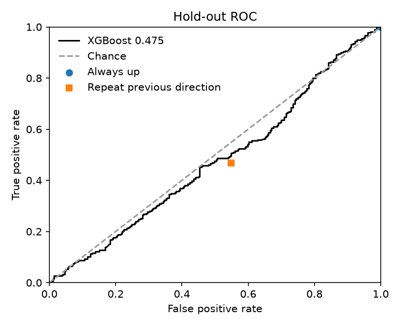
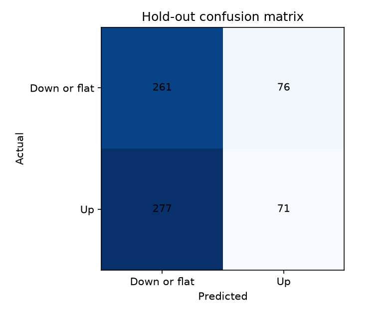

# 6. Hold-out

The classifier is fit once on the 3,723 development sessions, from 2007-07-03 through 2023-12-28. The settings are the ones chosen in the previous chapter: depth 9, minimum child weight 9, subsample 0.595, learning rate 0.013, and 925 trees. The columns are VolumeLag1, Ret1, CloseEMA8. The seed is 21. The fit does not see the hold-out.

The score uses the 685 hold-out sessions, from 2024-01-16 through 2026-10-09. The 10 sessions from 2024-01-02 through 2024-01-15 stay out of the fit and out of the score. A session is called up when the fitted probability is at least 0.5. The development cross-validation AUC was 0.5335. That number is not recomputed here.

Two reference rules use no fitted parameters. Always up predicts an up day every session. Repeat previous direction predicts that today's direction equals the direction of the immediately previous session. For the first hold-out day, that previous session is 2024-01-15.

Down hit counts down-or-flat days predicted as down-or-flat. Down miss counts those days predicted as up. Up miss counts up days predicted as down-or-flat. Up hit counts up days predicted as up. The always-up rule assigns the same score to every session, so its ROC AUC is 0.5.

## Hold-out scores

| Rule | Accuracy | ROC AUC | Down hit | Down miss | Up miss | Up hit |
| --- | --- | --- | --- | --- | --- | --- |
| XGBoost | 0.4847 | 0.4752 | 261 | 76 | 277 | 71 |
| Always up | 0.5080 | 0.5000 | 0 | 337 | 0 | 348 |
| Repeat previous direction | 0.4599 | 0.4597 | 152 | 185 | 185 | 163 |

The hold-out share of up days is 0.5080. Always up is therefore right on 0.5080 of the hold-out sessions. The fitted classifier is right on 0.4847, with ROC AUC 0.4752. Repeat previous direction is right on 0.4599, with ROC AUC 0.4597.

