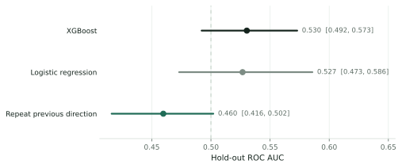
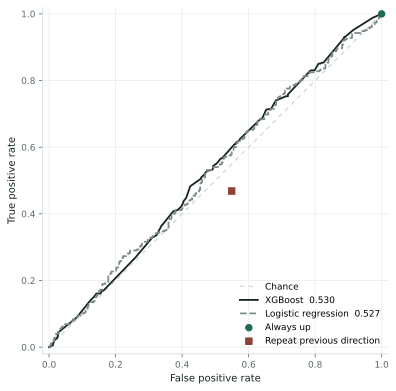

# 7. Hold-out

The classifier is fit once on the 3,723 development sessions, from 2007-07-03 through 2023-12-28. The settings are the ones chosen in the previous chapter: depth 1, minimum child weight 3, subsample 0.782, learning rate 0.007, and 51 trees. The columns are Ret1, Ret21, Mom12_1, RVol21, Parkinson21, LogVolChg1, Range1, Intraday1, Overnight1. The seed is 21. The fit does not see the hold-out.

The score uses the 685 hold-out sessions, from 2024-01-16 through 2026-10-09. The 10 sessions from 2024-01-02 through 2024-01-15 stay out of the fit and out of the score. A session is called up when the fitted probability satisfies

$$\hat y_t = \mathbf{1}\{\hat p_t \ge 1/2\}.$$

Three reference rules are scored with it. The logistic regression uses the same columns and has no tuned setting. Always up predicts an up day every session. Repeat previous direction predicts that today's direction equals the direction of the immediately previous session. For the first hold-out day, that previous session is 2024-01-15.

Down hit counts down-or-flat days predicted as down-or-flat. Down miss counts those days predicted as up. Up miss counts up days predicted as down-or-flat. Up hit counts up days predicted as up. With up as the positive class,

$$\mathrm{TPR} = \frac{\text{up hit}}{\text{up hit} + \text{up miss}}, \qquad \mathrm{FPR} = \frac{\text{down miss}}{\text{down miss} + \text{down hit}}.$$

The always-up rule assigns the same score to every session, so its ROC AUC is 0.5.

## Hold-out scores

| Rule | Accuracy | ROC AUC | Down hit | Down miss | Up miss | Up hit |
| --- | --- | --- | --- | --- | --- | --- |
| XGBoost | 0.5080 | 0.5303 | 0 | 337 | 0 | 348 |
| Logistic regression | 0.5226 | 0.5267 | 172 | 165 | 162 | 186 |
| Always up | 0.5080 | 0.5000 | 0 | 337 | 0 | 348 |
| Repeat previous direction | 0.4599 | 0.4597 | 152 | 185 | 185 | 163 |

The hold-out share of up days is 0.5080. Always up is therefore right on 0.5080 of the hold-out sessions. XGBoost is right on 0.5080, with ROC AUC 0.5303. All its fitted probabilities are above one half, so it calls every session up, like always up. The logistic regression is right on 0.5226, with ROC AUC 0.5267. Repeat previous direction is right on 0.4599.

## Chance or skill

With 685 sessions, part of any difference is chance. The hold-out is resampled 2,000 times in blocks of 20 consecutive sessions, and each rule is scored again on every sample. The middle 95 percent of those scores is the range below. The classifier counts as skilled only if its whole ROC AUC range sits above 0.5. That rule was set before the hold-out was scored. Log loss measures the fitted probabilities directly; lower is better.

| Rule | ROC AUC | 95% range | Log loss |
| --- | --- | --- | --- |
| XGBoost | 0.5303 | 0.4921 to 0.5729 | 0.6929 |
| Logistic regression | 0.5267 | 0.4731 to 0.5858 | 0.6922 |
| Always up | 0.5000 | 0.5000 to 0.5000 | 0.6930 |
| Repeat previous direction | 0.4597 | 0.4160 to 0.5020 | n/a |

The XGBoost range runs from 0.4921 to 0.5729. It includes 0.5, so the classifier shows no skill on the hold-out. With 685 sessions, a range clears 0.5 only when the ROC AUC is near 0.54 or higher.

